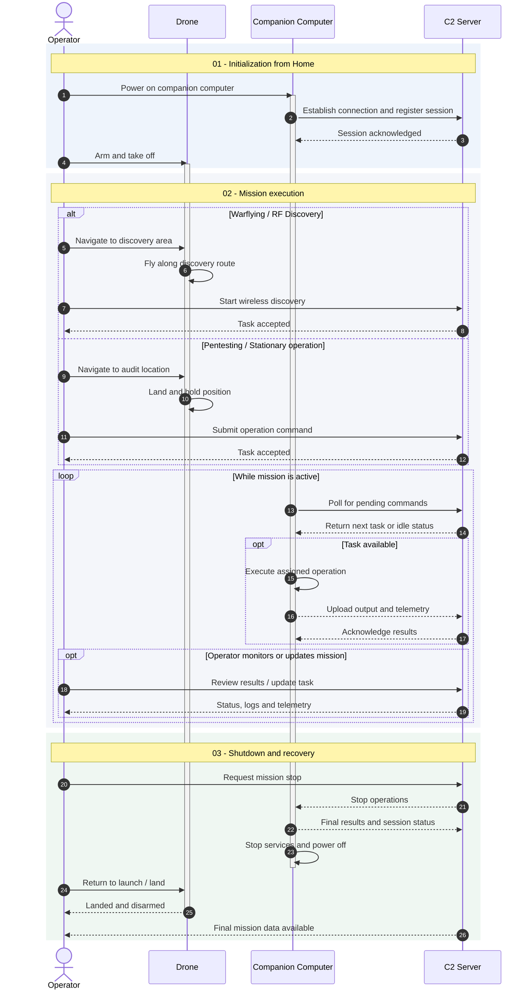


This project is still in its early stages, so this article will probably be updated frequently.


## 00 // Ground Control to Major Tom

Like me, if you're reading this around the time I'm writing it, \
you probably use AI every week (or every day) to help with various tasks.

I think we all know by now that AI can be both a blessing and a curse.

You can create, build and ship things absurdly faster than before. \
At the same time, it has never been easier to get the illusion that you understand something simply because a model managed to do it for you.

I'm not here to judge how people use AI... \
There are plenty of good uses and plenty of terrible ones.

I'm probably not even in a good position to pretend otherwise: \
part of what I'm currently specializing in is offensive tooling involving AI and the security of AI systems themselves.

But over time, something started to feel... exhausting.

I'm not exactly sure when it started.

Maybe it was seeing people farm school grades, certifications, projects and CTFs as if they were grinding Platinum Trophies without actually learning along the way.

Maybe it was the slightly uncomfortable realization that I'm still relatively junior in an industry where an increasing amount of what we do can now be imitated (sometimes impressively well) by AI sold by gigantic corporations. \
It's scary to think what the future of cybersecurity employment in France for juniors will be like...

Maybe I just got tired of seeing yet another vibe-coded tool solving a problem nobody had.

I plead guilty too, by the way... Front-end development isn't the part of IT that wakes me up excited in the morning.

Or maybe I simply got tired of reading publications written with AI by people who didn't seem to understand what they were publishing.

At some point I realized that AI everywhere had slowly removed part of the fun from things I used to genuinely enjoy while building.

Today, if I want to stay productive, I feel almost obligated to use it... (coding, documentation, research, boilerplate, debugging...)

And that's incredibly useful.

But I also miss something.

I remember learning to develop with Stack Overflow (🪦), asking stupid questions to DuckDuckGo, getting stuck for an hour because of one stupid bug, digging through documentation, writing code for days or weeks, and eventually being quite proud of something that probably isn't even that impressive today.

The important part was that I knew it !

I knew why each of my functions existed.

I knew which terrible decision had produced which terrible workaround.

I had suffered enough while building it that, by the end, the thing genuinely felt like mine and I had learned something.

As my studies progressed, the way I approached software naturally changed. \
I started spending more time on architecture, UML, testing, interfaces and system design.\

I started looking at projects as complete systems rather than piles of source files.

Cybersecurity came along.

When I started learning security in high school 6 years ago, general-purpose AI assistants weren't part of the picture yet. 
I was happily farming TryHackMe rooms and learning paths for a completely meaningless daily streak and futile leaderboard position, discovering topics that would later become part of my actual job. \
Then came PortSwigger Academy and web vulnerabilities, conferences, homelabs, CTFs... all the good stuff.

And then I basically got a front-row seat to the arrival of generative AI in higher education.

I remember doing a presentation about the Turing test during my first year of university for a communication class.

Not long after that (maybe two weeks after the presentation), ChatGPT 3 or 3.5 became publicly available.

Then things got progressively weirder.

Watching entire assignments, projects and eventually diplomas being carried by OpenAI or Anthropic subscriptions certainly didn't help my growing overdose.

Professionally, I still use these tools. A lot !

I think they're too useful not to.

But recently during coding sessions after finishing my architecture diagrams, somewhere between TDD, microservices skeletons, specifications and increasingly autonomous coding agents, I started asking myself a slightly uncomfortable question:

**Where the f\*ck is the fun left ?**

How do you remain proud of something when you barely struggled while making it ?

How do you make sure you're still learning rather than simply becoming very good at delegating/copying ?

How do you keep finding meaning in your work or in technical craft while increasingly large parts of that craft can be done by LLMs produced by companies that would love to replace you with their own SaaS if they could ?

How do I avoid being a meat proxy in 5 years ? 

I don't pretend to have an answer. But there are so many things we can still discuss as long as it affects our domain this deeply.

I had known for a long time I wanted to build something again. \

Something physical. \
Something that could burn, break, fall out of the sky, or at least force me to understand what I was doing before pressing Enter.

Feeling this way has been hard, honestly. \

I needed to recover that period when I built everything on my own, creating something tangible I'm proud of. 
A few weeks earlier, I attended a great workshop organized by tcccorp during PassTheSalt 2026 in Lille : \
[Design Your First PCB: From Concept to Board](https://cfp.pass-the-salt.org/pts2026/talk/AACNG9/)

That was my first proper introduction to PCB design and soldering.

And soldering was so fun.

With my friend **baldplayer123**, we left with the obvious conclusion that we needed a hardware project. \
Most of the things I've built during the last five years have barely involved electronics, soldering, PCB design, embedded systems or 3D printing. So whatever we picked, I wanted it to force me far outside my usual comfort zone.

We initially needed an excuse to design a PCB. \
But designing a random PCB just for the sake of ordering one felt slightly pointless for me.

If we were going to spend money and several months learning hardware, I wanted the PCB to be one small part of a larger project that actually made sense and that I could keep.

And one idea kept coming back.

**Could a computer I built actually fly ?**

While preparing my first physical intrusion scenarios, I had already wondered how useful it could be to position a network implant close to a target without necessarily having to physically enter the building first.

The idea sounded quite similar to something my teenage brain had already seen in Watch Dogs 2, \

flying a drone across vents and using it as an extension of your hacking capabilities.

Obviously, real life tends to contain slightly more physics, regulations and disappointment than Ubisoft games.

Still, the idea stuck in my head.

So the project slowly became more concrete and realistic; I wanted to build an FPV quadcopter carrying a Linux companion computer, its own power subsystem and additional radio/network interfaces, and see whether it could be that useful during operations.

That's what this series of articles is about.

I will show you every layer well enough to design it, build it, break it, repair it, use it.

------------------

## 01 // The Red Team problem I want to solve

Red Team engagements tend to combine several attack surfaces rather than treating security as a purely technical problem.

For the purpose of this project, I like to think of our operations as three broad families:

- attacks against information systems and exposed technical assets;
- social engineering against humans and organizational processes;
- physical access to places, devices and infrastructure.

Those categories obviously overlap, for example : 

- Phishing combines a technical delivery mechanism with social engineering.
- Tailgating combines social manipulation with physical intrusion.

- bypassing NAC involves the interaction between networks and physical access.

Wireless infrastructure sits in a similarly awkward place.

A Wi-Fi access point, Bluetooth device or IoT radio can be part of an internal information system while simultaneously exposing radio signals outside the physical perimeter that supposedly protects it.

That boundary is what I want to explore because physical intrusion can be difficult depending on the level of awareness, training, mitigations and time available.

It requires preparation, timing, social skills, operational security and often a healthy amount of luck.

In some environments, simply getting close enough to the infrastructure you want to observe can become the main constraint.

Walls attenuate radio signals.

Access points may sit deep inside offices or above floors that cannot easily be approached from public spaces or the street.

Bluetooth and IoT devices can have much shorter practical ranges.

And sometimes the interesting physical location simply isn't accessible from ground level.

This is where an aerial platform becomes interesting. A drone can move a radio receiver vertically as well as horizontally.

It can potentially inspect radio environments from angles that are difficult to reach from the ground.

It can also provide useful physical reconnaissance information about rooftops, access paths, cameras, external equipment, possible landing areas or simply a better understanding of the geometry of a site.

One scenario that originally motivated the project is the one below :

During an engagement, fly close to a building remotely from the hotel, land the quad onto the roof of the target, shut down the power-hungry flight systems while keeping a low-power companion computer alive, and use that computer as a remotely administered wireless assessment computer.

------------------

## 02 // capabilities of the red team drone

Before buying motors, antennas or cheap electronic boards from the Internet, I needed to define what I actually wanted the drone to do.

Otherwise this project would very quickly become the hardware equivalent of installing every Kali tool because maybe one of them will be useful someday without knowing what's installed.

The first version therefore has two separate capability sets:

1. cyber / RF capabilities provided by the companion computer;
2. drone capabilities required to deliver, operate and recover that computer.

### Companion-computer capabilities

| Capability            | Purpose                                                                              | passive/active | v1 priority  |
| -----------------------| --------------------------------------------------------------------------------------| ----------------| --------------|
| Wifi Discovery        | Observe nearby wireless infrastructure and basic radio metadata                      | Passive        | Required     |
| Wifi Pentesting       | Perform testing of wireless infrastructure                                           | Active         | High         |
| SSID/BSSID with GPS   | Build geolocated observations for wardriving/warflying experiments                   | Passive        | High         |
| Remote administration | Securely manage the companion computer while deployed                                | both           | High         |
| Rogue AP              | Credential stealing via phishing on fake/malicious networks                          | Active         | Medium       |
| Bluetooth discovery   | Observe nearby Bluetooth ecosystems and experiment with another short-range protocol | Active         | nice to have |
| Bluetooth Pentesting  | Explore BLE/Bluetooth attack surfaces                                                | Active         | nice to have |
| IoT                   | Extend the payload toward common embedded/home-automation protocols                  | Active         | nice to have |

All of the companion-side capabilities should eventually live behind a small framework I'm building for the project.

The current idea is to use Rust for most of the project, with Python if needed where using existing libraries makes more sense than rewriting half of the wireless ecosystem because I suddenly developed a personality disorder.

The exact software architecture deserves its own article later, so I will cover that later !

For now, the main requirements are simple:

- small / light footprint
- reproducible
- easy to deploy
- resilient to losing the remote connection as a "state machine"
- able to correlate radio observations with flight/GPS telemetry
- sufficiently modular

### Aircraft capabilities

| Feature                               | Purpose                                                                  | v1 priority |
| ---------------------------------------| --------------------------------------------------------------------------| -------------|
| Stable manual flight                  | The project becomes significantly less useful if converted into confetti | Required    |
| Reliable RC link                      | Maintain control over the aircraft                                       | Required    |
| GNSS positioning                      | Positioning, telemetry and navigation support                            | Required    |
| Companion-computer power              | Keep the payload electrically independent and stable                     | Required    |
| Flight telemetry exposed to companion | Correlation of cyber/RF data with aircraft position/state                | Required    |
| Companion isolation                   | Payload crash must not interfere with flight control                     | Required    |
| Failsafe / Return-to-Home             | Recover safely after selected failure conditions                         | High        |
| Long-range-oriented efficiency        | Carry additional payload without destroying endurance                    | High        |
| Recorded FPV feed from ground         | Useful for engagement evidence                                           | High        |
| Independent payload startup/shutdown  | Better energy management on the ground                                   | Medium      |
| Autonomous mission planning           | Enable planning for operations                                           | Optional    |

------------------

## 03 // State of the art 

Before making the screwdriver-3000, it is generally a good idea to check whether somebody has already invented the screwdriver. And of course wireless reconnaissance from moving platforms is obviously not new.

### Wardriving

At its simplest, wardriving consists of moving through an area while detecting nearby wireless networks and associating those observations with location data.

Historically, the setup was beautifully primitive/simple:

- a laptop, 
- a Wi-Fi adapter, 
- external antennas, 
- a GPS receiver 
- a car

One of the well-known early public demonstrations came from security researcher Pete Shipley in 2001, driving around San Francisco with an external antenna, laptop and GPS while mapping wireless networks.

Over time, almost everything required to do it became smaller, cheaper and considerably more accessible.

A modern phone can contain GNSS, Wi-Fi, Bluetooth, cellular connectivity, storage, a battery and enough compute power to perform tasks that once justified carrying a laptop covered in adapters.

Projects such as [WiGLE](https://wigle.net/) (the Wireless Geographic Logging Engine) turned individual observations into a collaborative geographic dataset. \
WiGLE has existed since 2001 and accepts geolocated wireless observations including network identifiers and security information. \
Its modern Android client can log Wi-Fi, Bluetooth and cellular observations together with their geographic position.

You can find on this site valuable information such as SSID, BSSID, channel or operating frequency, advertised capabilities, supported security mechanisms, signal-strength measurements from the receiving device, timing and vendor-related information in some cases...

An SSID is the human-readable network name being published (for example : something like "E-Corp Lobby")

A BSSID normally identifies a particular basic service set and is commonly represented by the MAC address of the radio interface associated with that access point.

A company can have twenty access points broadcasting the same SSID while each one exposes a different BSSID.

### From wardriving to warflying

Once wardriving exists, the obvious question for somebody with poor financial judgment is what happens if we move the receiver into the air ?

The term warflying is less common; it has been used to describe the idea of performing wireless reconnaissance or mapping from an aircraft or drone rather than from a ground vehicle.

And this is where the available material becomes surprisingly fragmented.

Searching for wardriving produces decades of tools, writeups, datasets and projects.

Searching for warflying usually produces a much lighter output (could also be a Dunning–Kruger :p ):

- research experiments by hobbyists attaching Wi-Fi hardware or whatever to commercial drones
- a few (un)documented conference talks
- security projects that never come to life
- abandoned GitHub repositories.

As far as I remember, the first person I heard about attempting something similar (a kind of Wi-Fi pentesting drone) was Nicolas Bourras, aka [vivescere](https://nicolasb.fr/). I saw his talk at SecSea 2024, although I can't remember how far he eventually pushed the project.

Then came some dorking.

"wardriving" "drone" \
"pentesting" "drone" \
"warflying" \
"computer companion" "pentest" \
"drone" "wifi pentesting" \
"red teaming" "drone" \

...and progressively worse combinations of them.

At best, I found things like [random Redditors strapping a Pwnagotchi](https://www.reddit.com/r/pwnagotchi/comments/14md9wx/does_this_count_as_warflying/) onto a DJI drone.

Which is cute.

But it's not quite as ambitious as what I have in mind. \
I wanted something handmade, ready to use, and as open as possible.

What interested me was the engineering around it, so I'll figure it out on my own:

- why a particular frame ?
- how much payload ?
- what happens to flight time ?
- how is the companion computer powered ?
- how electrically noisy is the drone ?
- where do the antennas go ?
- how does the Linux system communicate with the flight controller ?
- what happens when the companion crashes ?
- how are RF observations correlated with precise position ?
- was using a drone actually worth the trouble ?

That last question is easy to omit.

Because drones are cool. \
Putting Linux on things is cool too. \

Antennas sticking out of a custom carbon-fiber frame and 3D printed TPU make everything 67% more cyberpunk.

------------------

## 04 // More about physics ? Is the drone the right platform ? 

Does altitude really change what we can observe ?

Radio propagation is **heavily** affected by the environment. Walls, buildings, trees, cars and other obstacles can attenuate a signal, while large surfaces can reflect it. \
Signals can also bend around obstacles through diffraction, or reach the receiver through several different paths, creating multipath propagation.

With this in mind, the RF environment observed from the street can be quite different from the one observed several meters above it.

Having direct line-of-sight helps but it isn't the only thing that matters. There is also the Fresnel zone, which is an ellipsoidal area around the direct radio path. It can still be obstructed even when two antennas can technically see each other.

Antenna placement, shape and polarization also matter. \
On a drone this becomes particularly important because the battery, carbon frame and electronics all sit pretty close to the antennas and signal strength alone isn't the only important thing.

As mentioned, the different kinds of antennas can have a big impact on range / reception. For your information, here are some of the different types of antennas; we will use mushroom, bipole and patch antennas in this build. Here are some other types :

RSSI stands for received signal strength indicator, while SNR (signal-to-noise) compares that signal against the surrounding noise floor. A stronger RSSI doesn't necessarily mean that an access point is closer. \

It depends on transmission power, antenna gain, obstacles, reflections and interference. \

All that can change what the receiver sees.

Moving vertically can  reveal a different RF environment rather than simply a "stronger" one.

So the drone feels promising as it could make us able to discover different radio emitter. 

But to do so in a red team context we will also have to take into account endurance, mobility, max altitude, payload, durability, discretion, cost, complexity, accessibility to the target, setup, legal burden....... 

For conventional SSID mapping/wardriving, a car, bicycle or backpack will usually be much simpler. \

What the drone uniquely brings is three-dimensional mobility and access to observation points that are difficult to reach from the ground.

------------------

## 05 // The challenge of choosing the right FPV hardware

I wanted a quad large enough to carry additional electronics, efficient enough to remain useful once those electronics are installed, and open enough so I can share it / modify almost anything if needed. I also want it to be reliable, with the companion computer fault-tolerant enough that an error in a process on the companion computer doesn't also mean losing the mission/the drone.

FPV drones grew out of the RC and racing communities, and the ecosystem around them has become surprisingly mature. 

Motors, flight controllers, ESCs, radio receivers, GNSS modules, cameras, video transmitters and carbon frames are now available as fairly standardized building blocks and some are open source.  \

A lot of the complexity has moved from designing electronics yourself to understanding how existing components interact and selecting the right combination for a particular aircraft.

Open-source software has followed the same path. \

Projects such as ArduPilot, Betaflight, INAV, MAVLink and ExpressLRS now provide software stacks that would have required a ridiculous amount of engineering effort to reproduce from scratch.

EDIT from October : A new player has entered the open-source FPV hardware space, [OpenDrone](https://opendrone.be/). I will follow them to see if some pieces of my build can be replaced by their hardware. However, they don't have a 7" drone yet.  

3D printing also changed the way custom aircraft are built. 
If a GPS does not fit where you need it, you can design a mount. \
If an antenna needs to sit ten centimeters away from the frame, you can build a support for it. \

In this journey, FreeCAD (a 3D engineering/modeling open source alternative to SolidWorks) has become an important part of my design process

A typical commercial camera drone gives you a very polished quad, but most of the interesting engineering decisions have already been made by somebody else at DJI or whatever other brand. \

With a custom FPV build, the aircraft becomes closer to a flying chassis. \
I can decide where the compute lives, how it is powered, which radios it carries, where the antennas go, which firmware controls the aircraft and how the different systems communicate.

The trade-off is that every one of those decisions becomes my problem now...

### A hobby ecosystem that became very serious

It is difficult to talk about the current FPV ecosystem without mentioning the war in Ukraine.

The large-scale use of small drones by both Ukrainian and Russian forces has dramatically accelerated development, manufacturing and iteration using relatively inexpensive unmanned systems. \

In Ukraine alone, production moved into the millions of units per year, while engineering teams continuously adapted frames, heterogeneous electronics, communications and software around components that often came from the same broader commercial ecosystem used by hobbyists. \

Research published by RUSI describes this evolution as increasingly modular and component-driven, while also highlighting the enormous dependence of modern FPV supply chains on Chinese motors, batteries, electronics and raw materials. [source](https://www.rusi.org/explore-our-research/publications/commentary/drones-win-battles-components-win-wars)

Small FPV systems can be cheap enough to iterate rapidly, simple enough to repair locally and modular enough that a flight controller, radio link, motor or payload can be replaced without redesigning the entire aircraft. \

Ukraine's drone industry scaled this approach very aggressively; they report production in the order of millions of drones between 2024 and 2026. [source](https://www.csis.org/analysis/understanding-military-ai-ecosystem-ukraine)

### Which parts?

For this first version, I decided to build around a 7-inch "long-range" quadcopter.

It gives me considerably more space and payload margin than a typical 5-inch freestyle drone or 3/3.5-inch racing drone while remaining inside the world of relatively common FPV components. \

Efficiency also matters much more to me than aggressive acrobatics. \
I want enough thrust to carry the payload comfortably, then spend as little energy as practical keeping the entire thing in the air.

The exact component selection deserves much more than a shopping list, so the next article will go through the frame, motors, propellers, ESC, flight controller, GPS, receiver, FPV system, battery and power architecture individually plus all the things I had to buy on the side (screws, electrical tape, etc...).

------------------

## 06 // What does a warflying mission actually look like ?

The usage I have in mind corresponds to the following sequence : 

An operation begins before the props start spinning.

The quad first needs a valid configuration, charged batteries and working radio links. The companion computer has to boot independently, initialize its peripherals and C2 agent, then expose enough health information that I know whether the payload is actually usable before launching.

During takeoff and transit, the companion computer does nothing that is flight-critical.

Once the drone reaches the area of interest, the payload becomes more important. Depending on the engagement, it could remain in the air for a short observation pass, hover around a specific position or land somewhere safe and suitable for a longer audit.

Landing is interesting because propulsion is the largest consumer of energy onboard as a quadcopter continuously spends power just to avoid becoming a brick.

The Orange Pi does not.

If I can land the aircraft safely and keep the payload powered independently from the propulsion system, the useful lifetime of the red-teaming portion can become much longer than the flight endurance would suggest. \

At that point, the drone has effectively transported a small remotely administered Linux machine to a useful physical position.

The companion can then operate using whatever management path is available for the engagement. My current design assumes a remote redirector as part of that architecture, allowing the payload to exchange status, commands and collected results with infrastructure I control without tightly coupling the software to the operator's laptop.

------------------

## 07 // ATT&CK and adversarial simulation 

Since the project exists for red teaming, it could also make sense to position its capabilities against a framework commonly used to describe adversary behavior.

MITRE ATT&CK could be useful here, although the mapping needs some care.

MITRE ATT&CK describes adversary behavior around information systems. The quad is in the physical/RF domain, so there is no convenient technique called "T1337 - Put aircrack-ng on a quadcopter running Linux."

The useful mapping mostly starts with what the payload actually does once it is in position.

MITRE currently defines **Reconnaissance** as gathering information that can support future operations, while **Discovery** generally describes learning about an environment during an operation. **Collection** covers gathering information relevant to the adversary's objective, and **Command and Control** covers communications used to control systems under an adversary's control.

| Drone / payload capability | Red-team purpose                                  | ATT&CK relationship        |
| ----------------------------| ---------------------------------------------------| ----------------------------|
| Passive Wi-Fi mapping      | Build knowledge of nearby wireless infrastructure | Reconnaissance / discovery |
| Active network scanning    | Identify reachable hosts or services              | T1595 ( Active Scanning )  |
| Network traffic capture    | Observe traffic visible to the assessment system  | T1040 ( Network Sniffing ) |
| Rogue / Evil Twin AP       | Reproduce an adversarial Wi-Fi access point       | T1557.004 ( Evil Twin )    |
| Bluetooth / IoT discovery  | Expand knowledge of nearby devices                | Discovery / reconnaissance |

Once this build begins reproducing realistic adversary behavior, ATT&CK becomes useful for describing the purpose of those actions and for relating them to detection opportunities or defensive controls.

Also, if the platform can reproduce a technique, the engagement can also ask whether defenders would have noticed it.

- Would wireless monitoring detect an unexpected access point ?
- Would the SOC notice network activity originating from an unusual wireless segment?
- Would an Evil Twin alert fire?
- Would a new device association be visible?
- Would physical security notice a drone or a landed device?

That makes the drone more interesting to me than seeing it only as a flying collection of pentesting tools.

The objective of adversarial simulation is ultimately to exercise defenses in a realistic chain of events.

I really think that a drone gives us one more weird place from which that chain can begin.

------------------

## 08 // Addressing the elephant flying in the room

Now we need to talk about the part that can ruin this project much faster than a badly soldered ESC. 

**Regulation.**

I should think about how "legal" this project is and how it aligns with regulations in different places, and it would be a useful disclaimer, I guess (even though, if someone really wants to, with good or bad intentions, at their own risk, they can ignore the laws so...) ? 

As I'm creating it in France and may use it in different countries across the world... 

A drone being physically capable of flying somewhere does not mean I am allowed to fly it there, and having authorization to test a company's network does not automatically grant authorization to conduct any possible flight around the company's buildings.

Those are separate problems and I need both of them solved before treating a scenario as usable.

The details below reflect the rules I found while writing this article in **September/October 2026**. Drone regulation evolves regularly, especially around classes, remote identification and usages, so I will keep links to the official authorities rather than pretending this section can remain correct forever (I'm not a specialist).

### France and the European Union

European drone operations are organized primarily around three risk-based categories known as **Open**, **Specific** and **Certified**.

For a project like mine, the first important detail is that a home-built FPV drone is explicitly recognized by EASA (European Union Aviation Safety Agency) as a **privately built UAS**.

For privately built aircraft below 25 kg, operation in the Open category is generally possible in **A3**. The A3 rules require operation away from uninvolved people and at least **150 metres horizontally from residential, commercial, industrial or recreational areas** (🫩). Open-category operation also requires the aircraft to remain in visual line of sight and normally below **120 metres from the closest point of the Earth's surface**.

That single paragraph already has a fairly major impact on my original hotel-to-rooftop fantasy.

A self-built 7" drone flying several kilometres from the pilot toward a building and landing on its roof would generally fall well outside what I can simply do under the Open category.

The distance from built-up areas is a problem, at least in the EU.

BVLOS (Beyond Visual Line of Sight) is another one.

Depending on the exact operation, I would need to design the scenario around a legal VLOS flight environment or move into the **Specific category**, where operations outside Open-category limitations can be permitted through standard scenarios, predefined risk assessments or an operational authorization supported by an appropriate risk assessment such as SORA (Specific Operations Risk Assessment). EASA explicitly lists BVLOS as an example of an operation belonging to the Specific category.

That doesn't instantly kill the project.

It changes how I can test and demonstrate it :/

A lot of the engineering work can be validated in an authorized/private area or another suitable environment where distance, people and airspace can be managed safely. A realistic professional deployment would need to be planned according to the operation, aircraft, location and authorization...

France adds geographical restrictions on top of the European operational framework. Before a flight, the applicable drone zones and local airspace restrictions need to be checked using the official tools and current aeronautical information. The French administration provides a "Géoportail" layer for drone flight restrictions, while DGAC (Direction Générale de l'Aviation Civile) documentation covers both Open and Specific category operations.

### The United States

The American framework uses different terminology.

Professional and many non-recreational small-UAS operations generally fall under **FAA Part 107**. The FAA requires Part 107 aircraft to be registered and the remote pilot to meet certification requirements. Standard Part 107 operations keep the aircraft within visual line of sight, and the usual altitude ceiling is 120m / 400 ft above ground level, with specific provisions around structures and controlled airspace. Operations outside some of those constraints can require a waiver.

Remote ID also matters. The FAA requires most drones that are required to be registered to comply with Remote ID requirements, either through built-in Standard Remote ID, an appropriate broadcast module, or operation within an FAA-Recognized Identification Area when the relevant conditions are met.

The scenario has to be designed around the local aviation framework rather than taking a technically possible flight path and checking legality afterward.

### United Kingdom

The UK drone framework changed in January 2026.

The CAA's current Open Category retains the 120 m / 400 ft height limit and requires direct visual sight of the aircraft. Registration and pilot requirements depend on weight, class and camera equipment, with the current system using Flyer IDs and Operator IDs. \
More advanced operations belong under the Specific Category and have their own qualification and authorization requirements.

For a self-built aircraft, exact weight and operating environment again become very important.

Which is becoming a recurring theme...

### Then comes the cybersec side

A legal flight still does not grant permission to attack whatever happens to be in radio range.

For an engagement, the scope needs to be described precisely.

That becomes particularly important with wireless testing because RF does not stop neatly at a property boundary.

The access point belonging to the client may be sitting next to another company's network, a public hotspot and somebody's home router.

Passive observation, active scanning, authentication attempts, rogue access points and traffic interception therefore need to be treated as different actions rather than one vague category called “Wi-Fi hacking”.

In France, unauthorized access or maintenance within an automated data-processing system is covered by Article 323-1 of the Code pénal, while intentional disruption or alteration of such a system is separately covered by Article 323-2.

Radio regulations create another boundary around what the payload can transmit.

The 2.4 GHz and 5 GHz Wi-Fi bands are available under general authorization, but they still have technical operating conditions such as permitted power and usage rules. ANFR (Agence nationale des fréquences) also makes it clear that radio jammers are prohibited outside narrowly defined state exemptions and that causing harmful interference through non-compliant radio use can lead to criminal penalties.

Different countries have their own registration, spectrum, import, battery-transport rules and guidelines, so you should inform yourself before starting anything.

------------------

## 09 // What's next ?

I think we have a decent idea of what I'm getting myself into.

As for the rest of this series, here's what I have planned.

- Part 01 : Anatomy of a Flying Computer. \
  Understanding what quadcopters are made of and what every component actually does before selecting the hardware.
- Part 02 : Engineering the Build. \
  Comparing components, anticipating requirements, explaining my component choices and putting together the complete bill of materials (spoiler: it's expensive).
- Part 03 : ArduPilot on the FC. \
  Configuring the flight controller and installing ArduPilot...
- Part 04 : The Second Brain \
  Configuring the Orange Pi (flashing Linux on it, configuring UART...), its wireless interfaces, antennas and its hardware integration as a companion computer.
- Part 05 : Power, Wiring and Soldering. \
  Learning the necessary electronics, designing the power distribution, connecting the different systems and making sure everything survives its first power-up.
- Part 06 : Building the Aircraft. \
  Designing and printing custom mounts, assembling the quadcopter screw by screw, integrating the payload and documenting the physical build.
- Part 07 : Software Development between Companion Computer and FC \
  Integrating the companion computer and developing the software that will manage the payload.
- Part 08 : Did the Flying Computer Actually Work ? \
  Looking back at the results, failures, costs and compromises to figure out whether the whole thing was worth the effort.

Of course, this roadmap may evolve as I discover new problems, change my mind about certain components or realize that something I thought would take an afternoon actually requires three weeks and another order.

That's also part of why I'm documenting everything.

I want this series to be useful to somebody who has never built a drone, somebody interested in experimenting with embedded Linux and radio hardware, or another red teamer wondering whether a drone makes any practical sense for physical intrusion.

For now, there's a lot of work ahead, and I still have an entire aircraft to build before I can even think about flying it.

Next up, let's figure out how four motors and a bunch of electronics can keep a computer in the air.