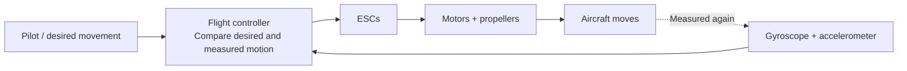
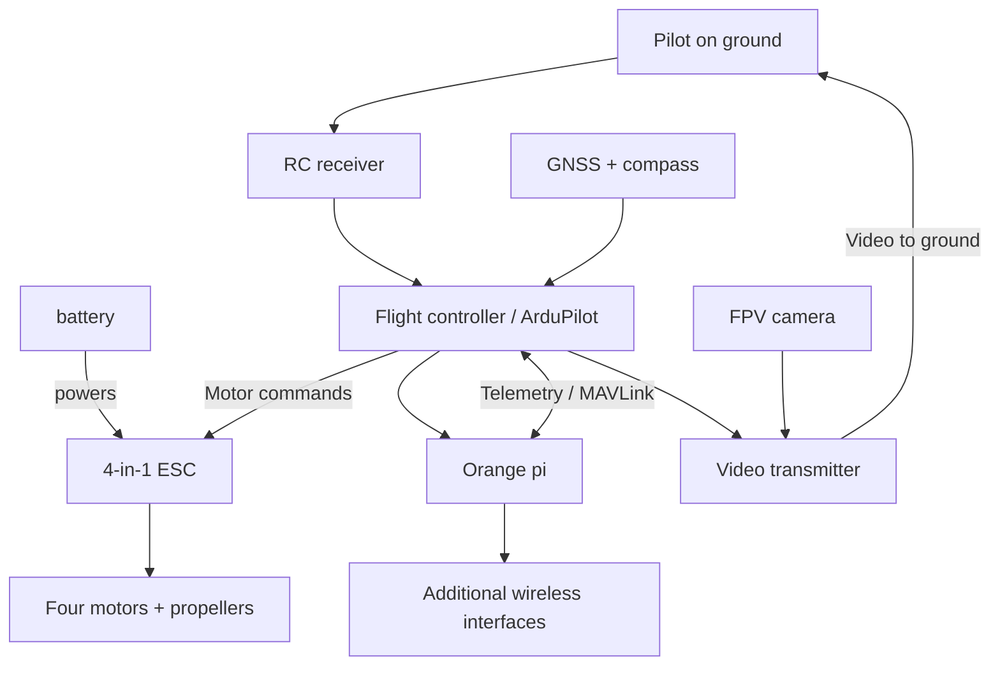


This project is still in its early stages, so this article will probably be updated frequently.


## 00 // Anatomy of a Flying Computer

I spent the previous article explaining why I wanted to put a Linux computer on a drone. By the time I'm writing this one, the component selection is done, the orders are placed and I've finished modelling the custom mounts in FreeCAD. There is still a rather important item on the TODO list: assembling the bloody thing.

Most of my background is in networks and software. My previous experience with aerodynamics and building aircraft came mostly from *Scrap Mechanic*, a game in which I've spent hundreds of hours assembling vehicles block by block, wiring logic circuits and making increasingly questionable flying machines. With the *Wings* mod, I ended up building planes, helicopters and even autopiloted drones. Apparently I enjoyed that enough to try it with real motors, real batteries and a considerably less forgiving and realistic physics engine.

The first challenge was learning what all the FPV components actually do. I knew why I wanted an Orange Pi onboard, but ESC ratings, motor KV, propeller pitch and flight-controller wiring were completely new territory. I had a lot of browser tabs open during the component selection, and I made this chapter out of the explanations that were useful while working through them.

I'll cover the physical principles and the parts of a quadcopter, using pieces from my seven-inch build where they help. Part 02 contains the complete shopping list, prices and reasons for choosing each reference. There is also some electricity here, plus enough acronyms to make the blue team feel at home.

## 01 // How does a quadcopter stay in the air?

A quadcopter flies by spinning four propellers that accelerate air downwards. The reaction produces an upward force called **thrust**. In a level hover, the four propellers together produce roughly the same force as the drone's weight. Increase their combined thrust and the aircraft climbs; decrease it and gravity wins.

The interesting part is that the four motors do different amounts of work. Their speed changes independently, allowing the drone to tilt and turn without the control surfaces found on a conventional aeroplane.

Pilots describe the aircraft's orientation using three axes. **Roll** tilts it sideways, **pitch** tilts its nose forward or backward, and **yaw** rotates it around its vertical axis. The throttle stick commands collective thrust, while the other stick inputs tell the flight controller how the aircraft should move. The exact response changes with the selected flight mode.

| Control                      | What you see                                | How the motors contribute                                  |
| ------------------------------| ---------------------------------------------| ------------------------------------------------------------|
| Throttle / collective thrust | The quad climbs or descends                 | The controller raises or lowers the combined thrust        |
| Roll                         | The aircraft tilts sideways                 | One side produces more thrust than the other               |
| Pitch                        | The nose goes down or up                    | The front and rear produce different amounts of thrust     |
| Yaw                          | The aircraft turns around its vertical axis | Opposite-rotating motor groups change their torque balance |

Two propellers rotate clockwise (**CW**) and the other two counter-clockwise (**CCW**). Each spinning propeller also produces a reaction torque on the frame. Alternating the rotation directions balances those torques during a hover, while changing the balance between the groups allows yaw control.

Pitch also explains forward movement. When the drone tilts its nose down, its thrust vector tilts forward with it, so some of that force accelerates the aircraft horizontally. The motors must still provide enough upward force to carry the complete weight. That's the reason a quad can move in any horizontal direction without wings or wheels.

I also had to pay attention to the **centre of gravity** while designing my frame layout. The battery, Orange Pi, external radios and their mounts all contribute to the aircraft's balance. Placing too much weight at one end makes the controller work harder to keep the quad level. The carbon arms, battery and any large printed parts also create aerodynamic drag once the aircraft starts moving forward. It turns out that finding a place where a component *fits* in FreeCAD is only half the design problem.

## 02 // The control loop

Four independent motors give a quadcopter its manoeuvrability, but they also make it very easy to flip the aircraft in a fraction of a second. A pilot cannot manually correct each motor several hundred times per second. That's the flight controller's job.

The **flight controller**, usually shortened to **FC**, continuously reads its motion sensors, compares the measured movement with the requested movement, then changes the four motor outputs. It repeats the process throughout the flight. The sensor measurements coming back after each correction form a **feedback loop**.

The **gyroscope** measures angular rotation rates, telling the controller how quickly the quad is rolling, pitching or yawing. The **accelerometer** measures specific force, including the effect of gravity when the aircraft is stationary. By combining these measurements, the controller can estimate its attitude and how that attitude is changing. Other sensors, such as a compass or barometer, help with heading and altitude where the chosen flight mode needs them.

You'll see the acronym **PID** often in FPV forums. It stands for Proportional, Integral and Derivative, three components of a feedback controller. The proportional term reacts to the current error, the integral term deals with accumulated error, and the derivative term reacts to how quickly the error changes. Together they help the FC turn stick input into controlled motion rather than four motors fighting each other. We'll get to actual configuration when I cover ArduPilot.

This also explains why I'm keeping a dedicated FC alongside the Orange Pi. A Linux computer is excellent at running scripts, tools, storing files and talking to remote services, but its normal operating system doesn't guarantee the timing expected by a flight-control loop. ArduPilot runs on the flight controller and handles flight-critical decisions. Even tough, there are many project of dyi around esp32 drone, howerver i don't thinks that it could fit well with my needs

## 03 // FPV drone families

**FPV** stands for **First Person View**. A camera on the drone sends a live view to the pilot, usually through goggles or a screen. That's what makes flying one feel different from watching a drone flying from the ground.

The awesome FPV community tends to describe its quadcopters using propeller diameter in inches (trop la honte), so a **5-inch** quad uses five-inch propellers. The number is a useful shortcut for the aircraft's general scale.

| Family           | What it tends to be good at                                 | What matters for my project                                                                                   |
| ------------------| -------------------------------------------------------------| ---------------------------------------------------------------------------------------------------------------|
| Tinywhoop        | Tiny and really cheap (< 100 €), often ducted indoor flying | Great to practise with but no room for my payload                                                             |
| 3–3.5-inch       | Lightweight, fast, agile flying in smaller spaces           | Compact, but payload and mounting space is too difficult                                                      |
| 5-inch           | Racing, freestyle and all-round custom FPV                  | Huge ecosystem, but additional computer, power and radios compete for space                                   |
| 7-inch           | Larger propellers, efficient cruising when well designed    | More room and a plausible starting point for the companion payload                                            |
| 8-inch and above | Larger payloads or specialised endurance/carry work         | More lifting options, with additional size and mechanical constraints could fit even better ban can cost more |

The words *racing*, *freestyle*, *cinematic* and *long-range* describe what a build is optimised for. A racing quad responds quickly to pilot commands, while a cinematic aircraft focuses on smooth footage. Long-range builds usually emphasise efficient flight, suitable batteries and navigation equipment. That's the family I ended up researching most seriously.

You'll also come across tricopters, hexacopters and octocopters. Those have three, six and eight motor positions respectively. Tricopters commonly use a tilting motor to control yaw; six- and eight-motor layouts distribute propulsion across more units. My build stays with four motors, partly because the standard quadcopter ecosystem covers all the flight hardware I need.

## 04 // Frame

The **frame** is the part that makes all those components an aircraft instead of a pile of electronics on my kitchen counter that any girlfriend could find irritating. It holds the motors, protects the internal stack and provides mounting points for the battery, camera and everything else I decide to attach with 3D printed pieces.

Carbon fiber is common in FPV frames because it offers high stiffness for relatively low weight (I was still surprised by how much the particular seven-inch frame I'd chosen weighed). That stiffness matters because a frame that twists too much changes how the motors and flight controller behave together. 

One less glamorous fact about carbon fibre is that **it conducts electricity**. A damaged wire pressed against a sharp carbon edge can create a short. Cable routing, insulation and the length of mounting screws belong in the design long before the first power-up.

Frames come in several geometries. In a **true X**, the motors sit at the corners of a fairly symmetrical X. A **deadcat** layout moves the front arms outward or changes their angles so the propellers are less likely to appear in the FPV camera's field of view. There are also stretched X and other layouts built around particular flight characteristics or vibration limitation.

## 05 // Motors

FPV quads generally use **brushless motors**. Inside a motor, copper windings form the stationary **stator**, while permanent magnets sit inside the rotating bell. The ESC energises the windings in sequence, causing the bell and its propeller to spin. This electronic control allows rapid speed changes with very little mechanical complexity.

The numbers printed on motor listings were one of the first things I had to decode. Take my **EMAX ECO II 2807 1300KV** motors. In the common FPV naming convention, **28** means a stator diameter of 28 mm and **07** means a stator height of 7 mm. Those are the dimensions of the stator inside the motor, so the complete motor is physically larger.

**1300KV** describes the approximate no-load speed constant, in revolutions per minute per volt. With a 6S LiPo's nominal 22.2 V, the arithmetic is straightforward: `1300 × 22.2 = 28,860 RPM`. That's a theoretical speed without a propeller attached. Once the motor has to turn seven inches of plastic through the air, the load and current rise and the actual RPM changes.

The motor also produces **torque**, the twisting force used to turn the propeller. Larger stator dimensions give the motor room for more magnetic material and copper, which helps it handle larger propeller loads. Current, heat and efficiency tell us how hard it is working.

Manufacturers often provide a **thrust table** for a motor. Look for the propeller tested, supply voltage, current draw and measured thrust. A row showing a motor producing a particular force at a particular current is useful for comparing setups. It describes that exact motor/propeller test, which is the data I used when sizing the seven-inch build.

## 06 // Propellers

The propeller is the part that turns the motor's rotation into a force on the air. Its blades have a shaped profile and an angle that make them accelerate air as they spin.

You can learn quite a lot from a propeller's reference. A label like **7×3.5×4** usually means a seven-inch diameter, a nominal 3.5-inch pitch and four blades. A label like **7×4.5×2** describes seven inches of diameter, 4.5 inches of pitch and two blades.

**Diameter** is the circle swept by the tips. It affects how much air the propeller can work with and how much clearance the frame needs. **Pitch** describes the distance a screw-like propeller would advance in one revolution through a solid medium. A higher pitch increases the load at a given RPM and can support more aggressive forward flight.

Blade count changes the balance again. More blades can provide useful thrust in a limited diameter, often with extra drag and current demand. Two-blade propellers are common in efficiency-focused builds (like mine), while tri-blades are popular where grip and responsiveness matter.

As said above, propellers also have a direction. They come in clockwise and counter-clockwise versions, and the correct propeller must match its motor's rotation. On the build we have to follow the ArduPilot motor-order documentation, verify the rotation with **propellers removed**, then install the props only after all the electrical and control checks are finished. I've grown attached to having my ten fingers.

## 07 // ESC

An **Electronic Speed Controller**, or **ESC**, drives brushless motors. It receives commands from the flight controller and switches the battery's electrical power through the motor's three phases to control how it turns. The three motor wires carries the ESC's controlled three-phase output.

Small FPV aircraft often use a **4-in-1 ESC**, a board containing four motor-control channels. \
It saves space and makes the internal wiring tidier. 

The current rating is one of the first specifications to check. An ESC marked **60 A** typically refers to a rated current for each motor channel under the manufacturer's stated conditions, rather than 60 A for the whole drone. 

There's one more mini board in my component pile worth introducing here. Power-filter boards and capacitors can help reduce some voltage spikes and electrical noise produced by fast-changing motor currents. The power-distribution and design will get its own article ;).

## 08 // Flight Controller

If I had to choose one component to understand properly before wiring the drone, it would be the **flight controller**. It's a small circuit board, but it's the core module of a drone. It keeps the quad stable, interpret the pilot's commands, read sensors, drive the motors.

At the centre is a **microcontroller unit** (MCU). Unlike a general-purpose Linux computer, it runs firmware built for tightly timed work. Many modern FPV FCs use STM32 microcontrollers. You'll often see families such as F4, F7 or H7 in product names. The family gives clues about processing resources and peripheral support, though the exact board layout matters at least as much as the chip.

The FC also carries an **IMU** (Inertial Measurement Unit), generally combining gyroscopes and accelerometers. Some boards have two IMUs for redundancy or sensor comparison. A **barometer**, when present, measures atmospheric pressure to help estimate changes in altitude. You'll also find regulators, memory, connectors and sometimes an OSD circuit for displaying flight information over analogue video.

| Part of the FC             | What it does ?                                                                                                   |
| ----------------------------| ------------------------------------------------------------------------------------------------------------------|
| **UART**                   | Serial communication with devices such as the RC receiver, GNSS module or Orange Pi                              |
| **I²C**                    | A two-wire bus commonly used by external sensors, including some compasses                                       |
| **SPI**                    | Faster synchronous connection commonly used by onboard sensors or memory                                         |
| **OSD**                    | Places flight information on the FPV video feed, when supported by the hardware and video system                 |
| **Blackbox / flight logs** | Records information used to diagnose flight behaviour; exact storage and log features vary by firmware and board |
| **5 V / 9 V rails, BECs**  | Regulated electrical supplies for the FC and                                                                     |

A UART is especially important for my project. It has a transmit line (**TX**) and a receive line (**RX**). Devices exchange serial data by connecting the relevant TX and RX lines and sharing a compatible signal reference. The Orange Pi and flight controller will use this link to exchange **MAVLink** messages, including position, flight state and battery telemetry.

There are several popular firmware choices. **Betaflight** dominates a lot of racing and freestyle builds. **INAV** adds navigation features familiar to FPV pilots. **ArduPilot** provides an extensive set of flight modes, navigation functions, mission tools, logs and interfaces for companion computers. I selected ArduPilot because this drone needs GNSS-based flight capabilities and direct communication with the Orange Pi. A system designed around a Linux payload benefits from those interfaces.

MAVLink is a messaging protocol that lets compatible systems exchange information such as position, attitude, battery status and commands. It isn't a flight controller firmware or a radio link by itself. In my case, the plan is for ArduPilot to run on the FC while the Orange Pi reads flight information such as GPS and manages its own software. 

ArduPilot can use information from the pilot, GPS, compass, barometer and other sensors to support modes such as **Stabilize** and **Return-to-Launch**. 

Before buying an FC, it's good to check the **exact ArduPilot board target**, available serial ports, power outputs and the differents capabilities of the FC... 

If you want to see how those pieces fit together before then, ArduPilot has a useful [overview of its inputs, sensors and outputs](https://ardupilot.org/copter/docs/common-basic-operation.html), along with its [frame and motor configuration documentation](https://ardupilot.org/copter/docs/frame-type-configuration.html).

## 09 // GPS and compass

I'm guilty of calling the little module on top of a drone a “GPS” even when it contains more than one sensor. Strictly speaking, **GNSS** is the broader term for satellite navigation systems, including GPS. A GNSS receiver can estimate position, ground speed and time from satellite signals. A **compass** is a different sensor, usually a magnetometer, which measures the surrounding magnetic field to help estimate heading.

Those measurements help the autopilot answer different questions. GNSS tells it where the aircraft is moving over the ground. The compass helps tell it which way the nose points. They can sit inside the same physical module while remaining separate sensors with different responsability.

This is why GPS/compass placement gets  attention on custom builds. High-current wires and motors generate magnetic fields that can disturb a compass. Builders often mount these modules on a little rear support or mast to give them some distance from the noisy components underneath.

## 10 // RC link

The **radio-control link** is how we tell the aircraft what to do. A handheld **transmitter** sends control information to a **receiver** mounted on the quad, which passes those commands to the flight controller. This is separate from the FPV video feed and separate again from whatever Wi-Fi or network connection the Orange Pi uses.

A good RC system needs low enough latency for control and a reliable link. The **uplink** carries pilot commands towards the aircraft. The **downlink**, where supported, carries telemetry back towards the transmitter. That's how a radio can show signal quality or other flight information instead of functioning as a one-way remote control.

I'll use **ExpressLRS**, an open-source radio-control ecosystem on 2.4 GHz. It supports telemetry and a range of receiver configurations. For link health, measurements such as **LQ** (Link Quality), RSSI and SNR are more informative together than a simplistic “signal bars” icon. The [ExpressLRS FAQ](https://www.expresslrs.org/faq/) explains well which values describe the uplink and downlink.

Some receivers use **antenna diversity**, where they can compare or select reception through multiple antennas. A true-diversity receiver can have separate receiver chains, depending on the model. This can help when one antenna is poorly oriented or partly blocked, but mounting both antennas in the same bad location rather defeats the purpose. Their angle, separation and distance from frame deserve some care.

## 11 // FPV video system

The FPV system is what lets the pilot see through the aircraft's camera. 

The **camera** captures the scene, and the **VTX** transmits the image through its antenna. A receiver on the ground decodes it and sends it to goggles or a monitor. If you want to record what the pilot sees, the recording can take place in the goggles, ground receiver or onboard equipment, depending on the system.

There are two broad families worth distinguishing. **Analogue FPV** often has inexpensive, fastest, lightweight hardware and a characteristic image that degrades progressively with interference. **Digital FPV** can provide better image quality and recording features, but system cost, power use, latency and interoperability depend on the particular product, the more common are DJI and Walksnail but they are a close ecosystem. Latency matters because the video shows the pilot what's happening *after* the camera has captured it. Too much delay makes precise flying uncomfortable/impossible for acrobatics.

Antennas matter here just as much as they did in the previous article's discussion of Wi-Fi. FPV systems may use linear or circular polarisation. Circularly polarised antennas are commonly labelled **RHCP** or **LHCP**, and transmitter and receiver antennas should have matching polarisation for a normal link. The antenna connector also has to match the VTX hardware.

The video transmitter needs power and somewhere to lose heat. Some units become very hot on the bench without airflow other have metal Heatsink. 

## 12 // Battery

The battery has two jobs in this design. It supplies the current demanded by four motors, and it carries enough energy to give the aircraft useful flight time. Every extra gram of battery also has to be lifted, which made selecting a pack much more interesting than picking the one with the biggest mAh number.

Here's the electricity needed to read a battery listing. **Voltage (V)** describes electrical potential, **current (A)** describes charge flowing through a circuit, **power (W)** is voltage multiplied by current, and **energy (Wh)** is power accumulated over time. A device using 10 W for one hour consumes 10 Wh. A battery's mAh rating describes charge capacity; voltage lets us turn that number into an approximate energy figure.

A **6S** pack connects six cell groups in **series**, adding their voltages. Lithium cells commonly used for FPV packs reach 4.2 V per cell when fully charged, giving **25.2 V** across a full six-cell series pack. At 3.7 V nominal per cell, the pack is advertised as **22.2 V nominal**. Some cylindrical Li-ion cells have a 3.6 V nominal rating, making the corresponding pack **21.6 V nominal**.

The letter **P** describes parallel cells inside each series group. A **6S2P** pack has two cells in parallel in each of its six groups, for a total of twelve cells. Parallel connections increase capacity at the same pack voltage. A six-series pack rated **5,000 mAh** stores roughly **111 Wh** when calculated using 22.2 V nominal (`22.2 × 5 = 111`). That example is about electrical energy; the actual flight duration comes from how much power the aircraft draws.

The **C rating** describes a claimed discharge rate relative to capacity. A 5 Ah pack marked 20C continuous claims `5 × 20 = 100 A` continuous discharge. Current delivery matters because motors can demand large bursts of power during acceleration, even if the aircraft spends most of its time cruising.

**LiPo** packs are widespread in performance FPV because they deliver high currents. **Li-ion** packs made from cylindrical cells are attractive for long-range cruising because of their energy density. I designed this quad around slower, efficient flight, so Li-ion was the chemistry I concentrated on during battery selection. 

Lithium batteries also deserve proper handling. A damaged pack can catch fire; I use a charger suited to the chemistry, check the pack before charging and keep the charging area suitable for lithium batteries. Flight-controller battery monitoring is part of the aircraft setup, so low-voltage warnings and failsafe behaviour can be configured from actual pack data. ArduPilot documents its [battery monitoring and failsafe settings](https://ardupilot.org/copter/docs/failsafe-battery.html).

## 13 // Thrust-to-weight ratio

The **all-up weight** (AUW) is the mass of the aircraft ready to fly, including the battery and every part of the companion payload. The combined thrust from the motors needs to lift that mass and leave enough reserve for turning, climbing and dealing with wind.

A quick way to describe the margin is the **thrust-to-weight ratio**. For example, suppose a fully equipped quad weighs **2 kg** and each of its four motors can produce **1 kgf** of thrust with the chosen propeller.

| Example only | Value |
|---|---:|
| All-up mass | 2 kg |
| Maximum thrust per motor | 1 kgf |
| Total maximum thrust | 4 kgf |
| Thrust-to-weight ratio | 2:1 |
| Thrust needed per motor in level hover | ~0.5 kgf |

The 2:1 ratio means the quad has about twice its weight available in maximum static thrust. A 1:1 setup would already need its full thrust just to hover, leaving no margin for control. This is why I used actual motor-and-propeller thrust data during the component selection rather than looking at KV alone.

## 14 // The mass/endurance feedback loop

The Orange Pi itself is small, but its regulator, external Wi-Fi hardware, antennas, connectors and 3D-printed mounts all add weight. Motors must work harder to carry it, and a larger battery brings its own extra mass. I could make the payload lighter or add more battery, but both choices affect the final layout.

That's why I worked on the battery position and component mounts in CAD before assembly, and why I tried to keep mass as low as possible while choosing parts.

## 15 // Putting the pieces together

After spending all this time on individual components, the complete aircraft is easier to picture if we separate **power**, **control**, **video** and **companion computer**.

This diagram deliberately leaves pin numbers and connector types. Those depend on the hardware selected in part 02 and the electrical design later in the series. The architecture gives me a useful boundary to keep in mind during development. 

## 16 // What's next?

It's easier for you now to understand why a quadcopter needs all thes parts. The frame carries the hardware, motors and props create thrust, ESCs drive the motors, and the flight controller keeps the aircraft under control using its sensors. GNSS, RC and FPV each brings different capabilities. The battery has to feed all of them while also being lifted by them.

The next article is where I stop talking about generic seven-inch drones and explain the components I picked for mine, my choices, the links of what i buy and account for the expensive little things that never seem to appear in an initial shopping cart.