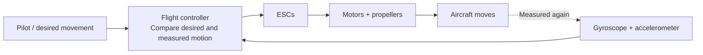
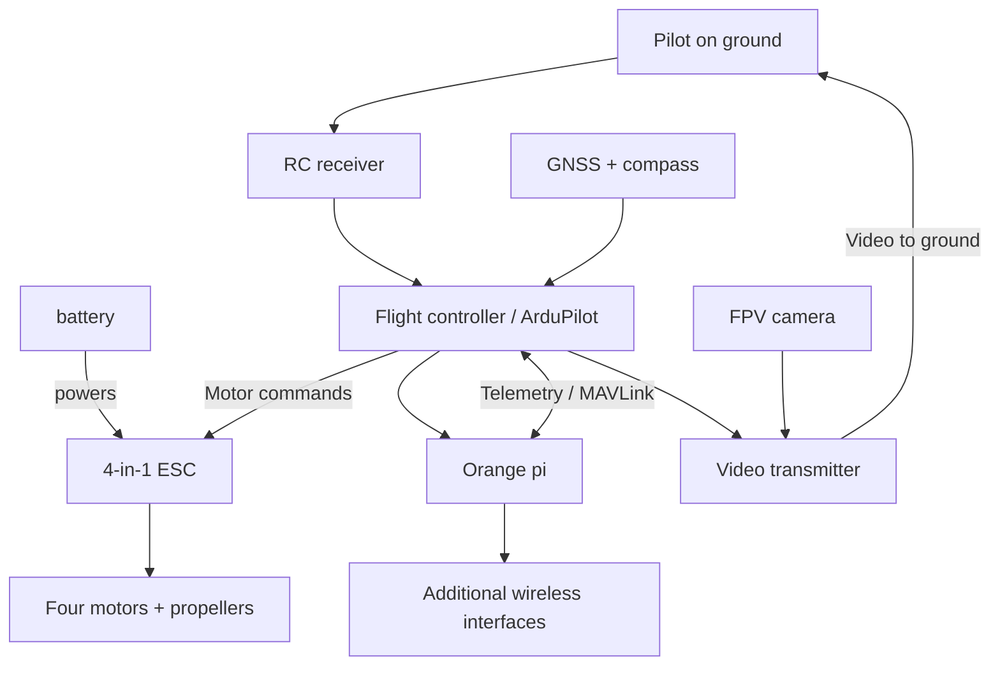


This project is still in its early stages, so this article will probably be updated frequently.


## 00 // Anatomy of a Flying Computer

I spent the previous article explaining why I wanted to put a Linux computer on a drone. \
There's still one fairly large detail to sort out before buying anything: understanding the thing that's supposed to compose my drone and carry the companion computer.

I came into this project knowing considerably more about networks than aeromodelling, my only experience on aerodynamism/crafting aircraft was trough the game "scrap mechanic" where you play a dwarf building bloc by bloc some incredible vehicule, i play hundreds of hours on this game that include boolean logic similar to minecraft's redstone and did some crazy build like planes, helicoptere, autopiloted drones with the mod "wings". 

I could explain what I'd want the Orange Pi to do once in the air or landed on top of a building, but if someone had asked me why a quadcopter needs four ESC channels, or what the numbers printed on a motor meant, I would have had to open a browser. Probably several tabs. This article is what I wish I'd had open when I started digging the rabbit hole.

We'll look at how a quadcopter flies, how its parts work together, and why a small FPV aircraft is quite different from the DJI/parrot  drones most people are familiar with. I'll use a few examples from my seven-inch project, but I'll keep the actual manufacturers, prices and component comparisons for part 02. \
There will be some physics too, a bit of electricity and enough acronyms to make the cybersecurity crowd (espcially blue team) feel like home.

## 01 // How does a quadcopter stay in the air?

Imagine putting four fans at the corners of a carbon-fiber frame, pushing air downwards. \
When they push enough air down, the resulting force pushes the aircraft upwards. \
That's the basic idea behind a quadcopter, although getting four motors to cooperate is where things become interesting.

Gravity pulls the complete drone towards the Earth. The propellers produce **thrust** in the opposite direction. \
If their combined upward thrust matches the aircraft's weight, the drone can hover. \
Increase it again and the aircraft accelerates upwards, then decrease it and it starts descending. \
Those simple descriptions assume the drone is more or less level, which won't always be the case.

A quadcopter also needs to control its orientation/angle. Pilots describe its movement around three axes as **roll**, **pitch** and **yaw**. Roll tilts it left or right, pitch tilts the nose up or down, and yaw rotates it left or right while keeping the aircraft broadly level. \
The throttle controls the total thrust available to perform those 3 movements.

| Control                      | What you see                                | How the motors contribute                                  |
| ------------------------------| ---------------------------------------------| ------------------------------------------------------------|
| Throttle / collective thrust | The quad climbs or descends                 | The controller raises or lowers the combined thrust        |
| Roll                         | The aircraft tilts sideways                 | One side produces more thrust than the other               |
| Pitch                        | The nose goes down or up                    | The front and rear produce different amounts of thrust     |
| Yaw                          | The aircraft turns around its vertical axis | Opposite-rotating motor groups change their torque balance |

The proppelers have alternate directions (cw and ccw for clockwise and counter clockwise). When a motor turns its propeller, it also applies a twisting reaction to the aircraft. Two motors rotate clockwise and two counter-clockwise so those reactions cancel in a hover. Change the balance between the two groups and the quad can yaw. \
Meanwhile, changing the thrust between front and rear or left and right produces pitch and roll.

Tilting is also how a quadcopter moves horizontally. Once it pitches forward, part of its thrust points forward instead of straight up, accelerating the aircraft in that direction. It often needs a little more total thrust to keep its altitude while tilted. This also explains why strong wind or aggressive manoeuvres can consume more battery than a gentle hover or cruise.

The **center of mass** matters here. Ideally, it should sit close to the point around which the aircraft is designed to rotate. An oversized battery hanging off the back forces the motors to compensate continuously. \
The drone will still fly, but the balance affects how much control authority and efficiency it has left. 

Aerodynamics play a part too, especially in forward flight. The frame, battery and payload all create drag. \
A large box/battery mounted underneath the aircraft might fit in the 3D while making the real machine less pleasant to fly.

## 02 // The control loop

There's a small problem with flying using four independent motors. The aircraft can change orientation very quickly, and by the time the pilot notices the mistake through FPV goggles, it may already be crashed somewhere.

The **flight controller**, usually shortened to **FC**, continuously reads sensors, estimates what the aircraft is doing and adjusts the motors to get closer to what the pilot or autopilot requested. This happens repeatedly and very quickly throughout the flight.

The **gyroscope** measures angular rotation rates, telling the controller how quickly the quad is rolling, pitching or yawing. The **accelerometer** measures specific force, including the effect of gravity when the aircraft is stationary. By combining these measurements, the controller can estimate its attitude and how that attitude is changing. Other sensors, such as a compass or barometer, help with heading and altitude where the chosen flight mode needs them.

You'll often see **PID** mentioned. It stands for Proportional, Integral and Derivative, three ways of using an error and its history to decide how strongly to correct it. For now, thinking of PID as part of the controller's method for turning a desired motion into motor corrections is enough. Tuning those values deserves its own afternoon of frustration after the drone is assembled.

This also explains why I'm keeping a dedicated FC alongside the Orange Pi. A Linux computer is excellent at running scripts, tools, storing files and talking to remote services, but its normal operating system doesn't guarantee the timing expected by a flight-control loop. ArduPilot runs on the flight controller and handles flight-critical decisions. Even tough, there are many project of dyi around esp32 drone, howerver i don't thinks that it could fit well with my needs

## 03 // FPV drone families

**FPV** stands for **First Person View**. A camera on the drone sends a live view to the pilot, usually through goggles or a screen. That's what makes flying one feel different from watching a drone flying from the ground.

The awesome FPV community tends to describe its quadcopters using propeller diameter in inches (trop la honte), so a **5-inch** quad uses five-inch propellers. The number is a useful shortcut for the aircraft's general scale.

| Family           | What it tends to be good at                                 | What matters for my project                                                                                   |
| ------------------| -------------------------------------------------------------| ---------------------------------------------------------------------------------------------------------------|
| Tinywhoop        | Tiny and really cheap (< 100 €), often ducted indoor flying | Great to practise with but no room for my payload                                                             |
| 3–3.5-inch       | Lightweight, fast, agile flying in smaller spaces           | Compact, but payload and mounting space is too difficult                                                      |
| 5-inch           | Racing, freestyle and all-round custom FPV                  | Huge ecosystem, but additional computer, power and radios compete for space                                   |
| 7-inch           | Larger propellers, efficient cruising when well designed    | More room and a plausible starting point for the companion payload                                            |
| 8-inch and above | Larger payloads or specialised endurance/carry work         | More lifting options, with additional size and mechanical constraints could fit even better ban can cost more |

There are also different numbers of arms and motors. A tricopter uses three motor positions and generally needs a mechanism to control yaw, a quadcopter has four, a hexacopter six and an octocopter eight. More motors can support different payload and redundancy requirements, but they also bring more parts, weight and cost. I think that four is a good starting point for a project I'm going to assemble and repair myself.

Then there's the distinction between freestyle, racing, cinematic and long-range designs. Racing values responsiveness, cinematic builds often prioritise smooth footage, and long-range designs put more attention into energy use and navigation. I'm interested in the last category because I want to lift a computer rather than practise split-S manoeuvres around abandoned buildings.

## 04 // Frame

The **frame** is the part that makes all those components an aircraft instead of a pile of electronics on my kitchen counter that any girlfriend could find irritating. It holds the motors, protects the internal stack and provides mounting points for the battery, camera and everything else I decide to attach with 3D printed pieces.

Carbon fiber is common in FPV frames because it offers high stiffness for relatively low weight (but i've been surprised that it's not that light for the frame i've chosen). That stiffness matters because a frame that twists too much changes how the motors and flight controller behave together. FIY, Carbon is electrically conductive, though, so exposed edges, damaged insulation and metal hardware deserve some attention when wiring the build.

Frames come in several geometries. In a **true X**, the motors sit at the corners of a fairly symmetrical X. A **deadcat** layout moves the front arms outward or changes their angles so the propellers are less likely to appear in the FPV camera's field of view. There are also stretched X and other layouts built around particular flight characteristics or vibration limitation.

## 05 // Motors

Most FPV quadcopters use **brushless motors**. Inside each motor, stationary copper windings form the *stator*, while a rotating bell carries magnets. Electronics energise those windings in sequence and pull the rotating part around. Brushless designs handle the repeated acceleration and deceleration needed for flight well, without the mechanical brushes found in some simpler motors.

Motor listings look cryptic at first, but the main numbers are fairly readable. Take **2807 1300KV**, for example. The `28` refers to a stator diameter of approximately 28 mm, and `07` to a stator height of 7 mm. Those dimensions describe the internal stator, so the complete motor is larger. Different manufacturers may add suffixes or use slightly different naming conventions.

The `1300KV` part means the motor's approximate **no-load speed constant**, expressed in revolutions per minute per volt. A 1300KV motor supplied with 22.2 V has a theoretical no-load speed in the range of 28,900 RPM. A real propeller adds load, so actual speed depends on the motor, voltage, ESC command and propeller.

The motor needs enough torque to turn its propeller under load. Torque is the twisting force available at the shaft, and the current flowing through the motor helps produce it. Larger stators can often handle larger propeller loads. 

Manufacturer **thrust tables** are useful too. They may report the thrust, current and power measured with a specific propeller at a given voltage and throttle setting. \

Heat matters too. Some electrical energy turns into heat inside the windings and ESCs. Overloading a motor or giving it poor airflow can make that a real problem.

## 06 // Propellers

The propeller is the part that turns the motor's rotation into a force on the air. Its blades have a shaped profile and an angle that make them accelerate air as they spin.

You can learn quite a lot from a propeller's reference. A label like **7×3.5×4** usually means a seven-inch diameter, a nominal 3.5-inch pitch and four blades. A label like **7×4.5×2** describes seven inches of diameter, 4.5 inches of pitch and two blades.

**Diameter** is the circle swept by the tips. It affects how much air the propeller can work with and how much clearance the frame needs. **Pitch** describes the distance a screw-like propeller would advance in one revolution through a solid medium. A higher pitch increases the load at a given RPM and can support more aggressive forward flight.

Blade count changes the balance again. More blades can provide useful thrust in a limited diameter, often with extra drag and current demand. Two-blade propellers are common in efficiency-focused builds (like mine), while tri-blades are popular where grip and responsiveness matter.

As said above, propellers also have a direction. They come in clockwise and counter-clockwise versions, and the correct propeller must match its motor's rotation. On the build we have to follow the ArduPilot motor-order documentation, verify the rotation with **propellers removed**, then install the props only after all the electrical and control checks are finished. I've grown attached to having my ten fingers.

## 07 // ESC

An **Electronic Speed Controller**, or **ESC**, drives brushless motors. It receives commands from the flight controller and switches the battery's electrical power through the motor's three phases to control how it turns. The three motor wires carries the ESC's controlled three-phase output.

Small FPV aircraft often use a **4-in-1 ESC**, a board containing four motor-control channels. \
It saves space and makes the internal wiring tidier. 

The current rating is one of the first specifications to check. An ESC marked **60 A** typically refers to a rated current for each motor channel under the manufacturer's stated conditions, rather than 60 A for the whole drone. 

There's one more mini board in my component pile worth introducing here. Power-filter boards and capacitors can help reduce some voltage spikes and electrical noise produced by fast-changing motor currents. The power-distribution and design will get its own article ;).

## 08 // Flight Controller

If I had to choose one component to understand properly before wiring the drone, it would be the **flight controller**. It's a small circuit board, but it's the core module of a drone. It keeps the quad stable, interpret the pilot's commands, read sensors, drive the motors.

At the centre is a **microcontroller** (MCU). Unlike a general-purpose Linux computer, it runs firmware built for tightly timed work. Many modern FPV FCs use STM32 microcontrollers. You'll often see families such as F4, F7 or H7 in product names. The family gives clues about processing resources and peripheral support, though the exact board layout matters at least as much as the chip.

The FC also carries an **IMU** (Inertial Measurement Unit), generally combining gyroscopes and accelerometers. Some boards have two IMUs for redundancy or sensor comparison. A **barometer**, when present, measures atmospheric pressure to help estimate changes in altitude. You'll also find regulators, memory, connectors and sometimes an OSD circuit for displaying flight information over analogue video.

| Part of the FC    | What it does ?     |
|---|---|
| **UART** | Serial communication with devices such as the RC receiver, GNSS module or Orange Pi |
| **SPI** | Faster synchronous connection commonly used by onboard sensors or memory |
| **OSD** | Places flight information on the FPV video feed, when supported by the hardware and video system |
| **Blackbox / flight logs** | Records information used to diagnose flight behaviour; exact storage and log features vary by firmware and board |
| **Power rails / BECs** | Provide regulated voltages for the FC or connected peripherals, within their ratings |

Think of a UART as a conversation between two electronic devices over a pair of signal lines. SPI is an other ways of connecting peripherals with different wiring and communication rules. 

Now comes the firmware. **Betaflight** is widely used for FPV racing and freestyle, where responsive manual flight is a major priority. **INAV** offers navigation-oriented features alongside FPV support. **ArduPilot** has an extensive autopilot and mission system, logging, configurable failsafes and support for external computers through **MAVLink**. 

MAVLink is a messaging protocol that lets compatible systems exchange information such as position, attitude, battery status and commands. It isn't a flight controller firmware or a radio link by itself. In my case, the plan is for ArduPilot to run on the FC while the Orange Pi reads flight information such as GPS and manages its own software. 

ArduPilot can use information from the pilot, GPS, compass, barometer and other sensors to support modes such as **Stabilize** and **Return-to-Launch**. 

Before buying an FC, it's good to check the **exact ArduPilot board target**, available serial ports, power outputs and the differents capabilities of the FC... 

If you want to see how those pieces fit together before then, ArduPilot has a useful [overview of its inputs, sensors and outputs](https://ardupilot.org/copter/docs/common-basic-operation.html), along with its [frame and motor configuration documentation](https://ardupilot.org/copter/docs/frame-type-configuration.html).

## 09 // GPS and compass

I'm guilty of calling the little module on top of a drone a “GPS” even when it contains more than one sensor. Strictly speaking, **GNSS** is the broader term for satellite navigation systems, including GPS. A GNSS receiver can estimate position, ground speed and time from satellite signals. A **compass** is a different sensor, usually a magnetometer, which measures the surrounding magnetic field to help estimate heading.

Those measurements help the autopilot answer different questions. GNSS tells it where the aircraft is moving over the ground. The compass helps tell it which way the nose points. They can sit inside the same physical module while remaining separate sensors with different responsability.

This is why GPS/compass placement gets  attention on custom builds. High-current wires and motors generate magnetic fields that can disturb a compass. Builders often mount these modules on a little rear support or mast to give them some distance from the noisy components underneath.
## 10 // RC link

The **radio-control link** is how we tell the aircraft what to do. A handheld **transmitter** sends control information to a **receiver** mounted on the quad, which passes those commands to the flight controller. This is separate from the FPV video feed and separate again from whatever Wi-Fi or network connection the Orange Pi uses.

A good RC system needs low enough latency for control and a reliable link. The **uplink** carries pilot commands towards the aircraft. The **downlink**, where supported, carries telemetry back towards the transmitter. That's how a radio can show signal quality or other flight information instead of functioning as a one-way remote control.

I'll use **ExpressLRS**, an open-source radio-control ecosystem on 2.4 GHz. It supports telemetry and a range of receiver configurations. For link health, measurements such as **LQ** (Link Quality), RSSI and SNR are more informative together than a simplistic “signal bars” icon. The [ExpressLRS FAQ](https://www.expresslrs.org/faq/) explains well which values describe the uplink and downlink.

Some receivers use **antenna diversity**, where they can compare or select reception through multiple antennas. A true-diversity receiver can have separate receiver chains, depending on the model. This can help when one antenna is poorly oriented or partly blocked, but mounting both antennas in the same bad location rather defeats the purpose. Their angle, separation and distance from frame deserve some care.
## 11 // FPV video system

The FPV system is what lets the pilot see through the aircraft's camera. 

The **camera** captures the scene, and the **VTX** transmits the image through its antenna. A receiver on the ground decodes it and sends it to goggles or a monitor. If you want to record what the pilot sees, the recording can take place in the goggles, ground receiver or onboard equipment, depending on the system.

There are two broad families worth distinguishing. **Analogue FPV** often has inexpensive, fastest, lightweight hardware and a characteristic image that degrades progressively with interference. **Digital FPV** can provide better image quality and recording features, but system cost, power use, latency and interoperability depend on the particular product, the more common are DJI and Walksnail but they are a close ecosystem. Latency matters because the video shows the pilot what's happening *after* the camera has captured it. Too much delay makes precise flying uncomfortable/impossible for acrobatics.

Antennas matter here just as much as they did in the previous article's discussion of Wi-Fi. FPV systems may use linear or circular polarisation. Circularly polarised antennas are commonly labelled **RHCP** or **LHCP**, and transmitter and receiver antennas should have matching polarisation for a normal link. The antenna connector also has to match the VTX hardware.

The video transmitter needs power and somewhere to lose heat. Some units become very hot on the bench without airflow other have metal Heatsink. 
## 12 // Battery

The battery decides how long the aircraft can fly, how much current the motors can draw and how much extra mass they have to carry. It also happens to be one of the parts that can be dangerous so it's important to treat it with care as it can burst into fire.

A quick electricity refresher will make the labels less mysterious. **Voltage (V)** describes electrical potential. **Current (A)** describes the rate of charge flow. **Power (W)** is how quickly electrical energy is transferred, and in a simple DC calculation it equals voltage multiplied by current. **Energy (Wh)** tells us how much work a battery can supply over time. Capacity in **amp-hours (Ah)** is useful too, but it only makes sense alongside the battery voltage when comparing stored energy.

A battery marked **6S** has six cells or cell groups connected in **series**, so their voltages add. A **6S LiPo** is commonly labelled 22.2 V nominal and reaches 25.2 V when fully charged at 4.2 V per cell. Some Li-ion cells use a nominal rating of 3.6 V instead of 3.7 V, which is why you might also see a six-cell pack advertised as 21.6 V nominal. The supported charge voltage must always come from the actual cell specification.

The **P** in a designation such as **6S2P** means two cells in parallel per series group. Parallel cells increase the pack's capacity at the same nominal voltage and can increase available current when the cells and construction allow it. A 6S2P pack therefore contains twelve individual cells.

Here is a simple energy example. A 6S LiPo rated at **5,000 mAh** has 5 Ah of capacity. Using 22.2 V nominal gives approximately **111 Wh**. 

The other number you'll see is the **C rating**. It describes a claimed discharge rate relative to capacity. A 5 Ah pack labelled 20C would claim 100 A of continuous discharge capability if the rating is specified as continuous. 

For this project, I'm comparing two common lithium chemistries. **LiPo** packs are popular in performance FPV because suitable packs can deliver high currents. **Li-ion** cylindrical-cell packs can offer good energy per unit of mass for efficient cruising, but many cells have lower discharge-current capability. As i prefere slow fly without acrobatics and more cruise like, i would prefere li-ion over lipo.

I'll use a good charger, follow the manufacturer's advices, buy brand news batteries. Damaged or swollen lithium packs are **a serious fire risk**. ArduPilot also supports battery monitoring and configurable low/critical battery responses which only work when the monitoring hardware and parameters are set up correctly. Its [battery failsafe documentation](https://ardupilot.org/copter/docs/failsafe-battery.html) is worth keeping nearby to not crash this expensive project.

## 13 // Thrust-to-weight ratio

The aircraft's **all-up weight** (AUW) includes the frame, motors, electronics, props, battery and payload, ready for flight. The motors and propellers have to produce enough combined thrust to support that complete mass, with some reserve for steering, wind and climbing.

You'll often see builders express this as a **thrust-to-weight ratio**. It compares maximum available thrust with the aircraft's weight. For a quick estimate, thrust is often quoted in gram-force or kilogram-force and compared numerically with the aircraft's mass in grams or kilograms under ordinary gravity.

| Example for illustration  | Value |
|---|---:|
| All-up mass | 2.0 kg |
| Measured maximum thrust per motor | 1.0 kgf |
| Four-motor maximum thrust | 4.0 kgf |
| Thrust-to-weight ratio | 2:1 |
| Approximate thrust required per motor in level hover | 0.5 kgf |

At 1:1, the aircraft would have essentially no useful reserve at the conditions used for that maximum-thrust figure. A higher ratio leaves more room to control the quad, although the ideal amount depends on the mission. 

It also doesn't mean a 2:1 drone hovers at exactly 50% throttle. The relationship between throttle command, motor speed and thrust isn't linear, and the controller has other things to compensate for.

## 14 // The mass/endurance feedback loop

The companion computer makes this whole design a little annoying in a very predictable way. The Orange Pi has mass. Its battery, Wi-Fi adapter, antennas, printed supports and cables have mass too. Every gram needs lifting, and lifting needs energy.

A larger battery may give the aircraft more stored energy but it also increases the mass carried throughout the flight. Eventually the added battery weight gives diminishing returns. 

That's why I'm planning to weigh separatly drone and payload so i keep the power requirements of the companion computer separate from the propulsion figures. 

## 15 // Putting the pieces together

After spending all this time on individual components, the complete aircraft is easier to picture if we separate **power**, **control**, **video** and **companion computer**.

This diagram deliberately leaves pin numbers and connector types. Those depend on the hardware selected in part 02 and the electrical design later in the series. The architecture gives me a useful boundary to keep in mind during development. 

## 16 // What's next?

It's easier for you now to understand why a quadcopter needs all thes parts. The frame carries the hardware, motors and props create thrust, ESCs drive the motors, and the flight controller keeps the aircraft under control using its sensors. GNSS, RC and FPV each brings different capabilities. The battery has to feed all of them while also being lifted by them.

The next article is where I stop talking about generic seven-inch drones and explain the components I picked for mine, my choices, the links of what i buy and account for the expensive little things that never seem to appear in an initial shopping cart.